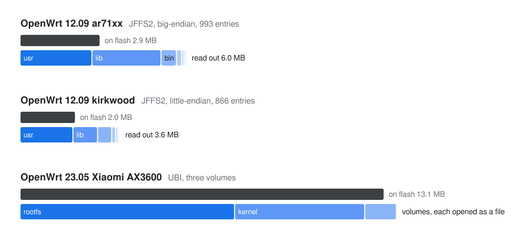

# flashfs

Read-only reader for embedded flash filesystems: JFFS2, cramfs, UBI and UBIFS, in C99, without
mounting and without root.

Images come from firmware someone else built, so the library treats them as hostile: every size,
offset and count is checked against the bytes present and against a budget before it is used, and
a damaged image still yields what can be read, with a report of what could not.

<picture>
  <source media="(prefers-color-scheme: dark)" srcset="docs/images/flash-dark.svg">
  
</picture>

## Build and install

```sh
cmake -S . -B build -DBUILD_SHARED_LIBS=ON
cmake --build build
cmake --install build --prefix /usr/local
```

zlib, liblzma, liblzo2 and libzstd are used when found (`FLASHFS_WITH_ZLIB`, `FLASHFS_WITH_LZMA`,
`FLASHFS_WITH_LZO`, `FLASHFS_WITH_ZSTD`). Without one, the files that need it read as
`MTDF_ERR_UNSUPPORTED`; `mtdf_features()` says which decoders the build has.

Use it from CMake:

```cmake
find_package(flashfs REQUIRED)
target_link_libraries(app PRIVATE flashfs::flashfs)
```

Or with pkg-config (`--static` for the static library):

```sh
cc app.c $(pkg-config --cflags --libs flashfs)
```

## Single-file form

`scripts/amalgamate.sh` writes `dist/flashfs/flashfs.h`. Copy it into your project and, in exactly
one `.c` file:

```c
#define MTDF_IMPLEMENTATION
#include "flashfs/flashfs.h"
```

Define `MTDF_STATIC` as well to keep every function private to that file, and `MTDF_HAVE_ZLIB`,
`MTDF_HAVE_LZMA`, `MTDF_HAVE_LZO`, `MTDF_HAVE_ZSTD` for each decoder you link.

## Usage

```c
mtdf_fs_t *fs;
mtdf_ino_t ino;
mtdf_stat_t st;
char buf[4096];
size_t got;

if (mtdf_open_mem(image, image_len, NULL, &fs) != MTDF_OK)
    return;
if (mtdf_lookup(fs, "/etc/passwd", MTDF_LOOKUP_FOLLOW, &ino) == MTDF_OK &&
    mtdf_stat(fs, ino, &st) == MTDF_OK &&
    mtdf_read(fs, ino, 0, buf, sizeof(buf), &got) == MTDF_OK)
    fwrite(buf, 1, got, stdout);
mtdf_close(fs);
```

A UBIFS usually lives in a UBI volume. flashfs shows each volume as a file, and the UBIFS in it opens
through a callback that reads that file:

```c
static int volume_read(void *ctx, uint64_t offset, void *buf, size_t len)
{
    struct volume *v = ctx; /* the UBI handle and the volume's inode */
    size_t got;

    for (; len > 0; offset += got, len -= got, buf = (char *)buf + got)
        if (mtdf_read(v->ubi, v->ino, offset, buf, len, &got) != MTDF_OK || got == 0)
            return -1;
    return 0;
}

/* ubi from mtdf_open_mem, v.ino from mtdf_lookup(ubi, "/rootfs", ...), size from mtdf_stat */
mtdf_open_cb(volume_read, &v, st.size, NULL, &rootfs);
```

Close the UBIFS handle before the UBI one. A UBIFS image written by `mkfs.ubifs` opens directly.

[`examples/mtdf-ls.c`](examples/mtdf-ls.c) lists an image read through a callback;
[`examples/mtdf-extract.c`](examples/mtdf-extract.c) extracts it into a new directory without
writing outside it. The header `include/flashfs/flashfs.h` is the API reference.

Conventions:

- every function that can fail returns `MTDF_OK` or an error code; `mtdf_strerror` names it
- `mtdf_open_mem` does not copy the image: it must outlive the handle; `mtdf_open_cb` reads through
  your callback instead, a window at a time
- names and pointers the library returns belong to the handle and live until `mtdf_close`
- `mtdf_options_t`, zero-initialized, takes the limits (depth, decoded bytes, file size, index
  records) and an allocator; `NULL` means the defaults and `malloc`/`free`
- `mtdf_report` counts what opening found damaged and left out; nothing is hidden
- a handle is not thread-safe: one per thread, or a lock around every call

## Performance

Measured by `bench/run.sh` on one machine (2026-05-17), release build, images in memory, median
of 7 runs (3 for Python; the corpus is one pass). The Python column is fwtriage's reader, which
flashfs was extracted from, on the same images.

| image | open + list | read everything | heap peak while listing | Python, probe + unpack |
|---|---|---|---|---|
| JFFS2, 16 MiB, zlib, 1770 entries | 7.4 ms | 79 ms (318 MB/s) | 5.7% of the image | 178 ms |
| cramfs, 14.5 MB, 1770 entries | 5.7 ms | 82 ms (305 MB/s) | 1.7% | 114 ms |
| UBI, 128 MiB, one volume | 0.18 ms | 5 ms | 0.12% | 260 ms |
| fwtriage's test corpus, 874 images | | 10.6 ms in all | | 187 ms in all |

Opening builds an index and decodes nothing; reading a zlib image is bound by zlib itself:
inflating the JFFS2 image's 6247 zlib nodes alone takes 86 ms (`bench/zlib_floor.py`).

## Versioning

Semantic Versioning. Compatible releases bump the minor version; incompatible ones bump the
major version and the soname. See [CHANGELOG.md](CHANGELOG.md).

## License

MIT, see [LICENSE](LICENSE).
